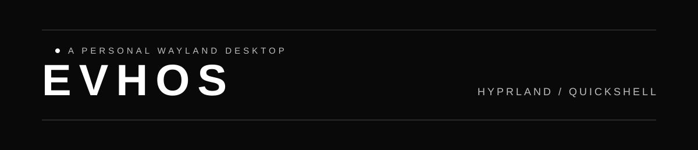
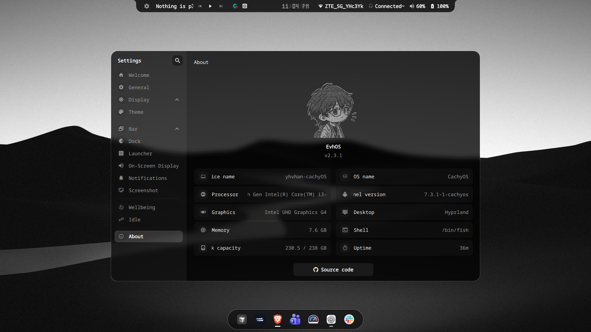
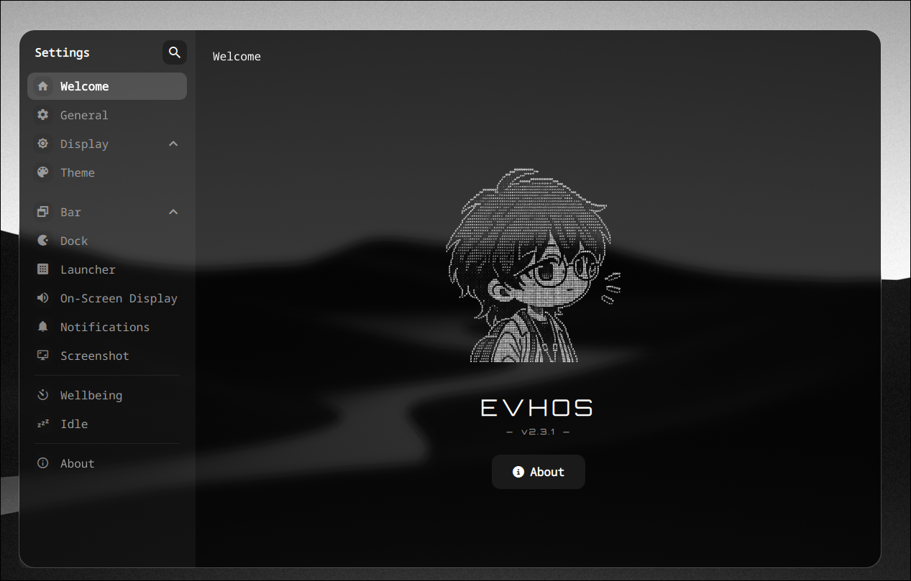
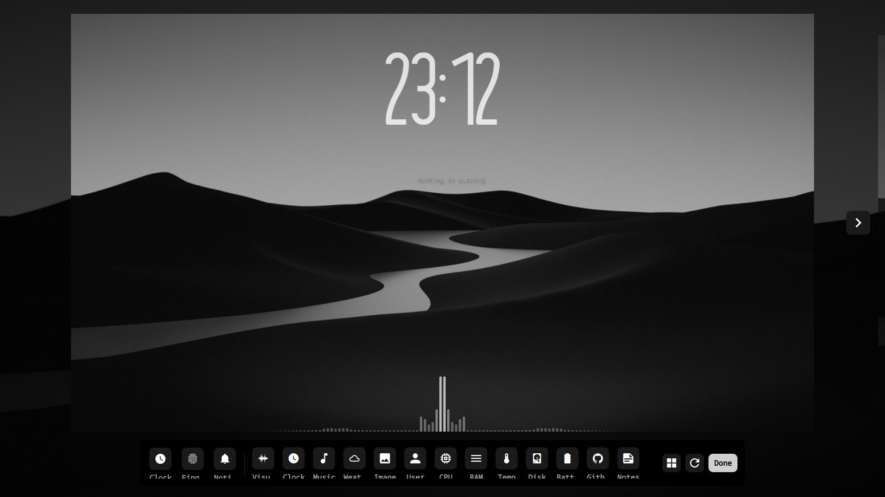
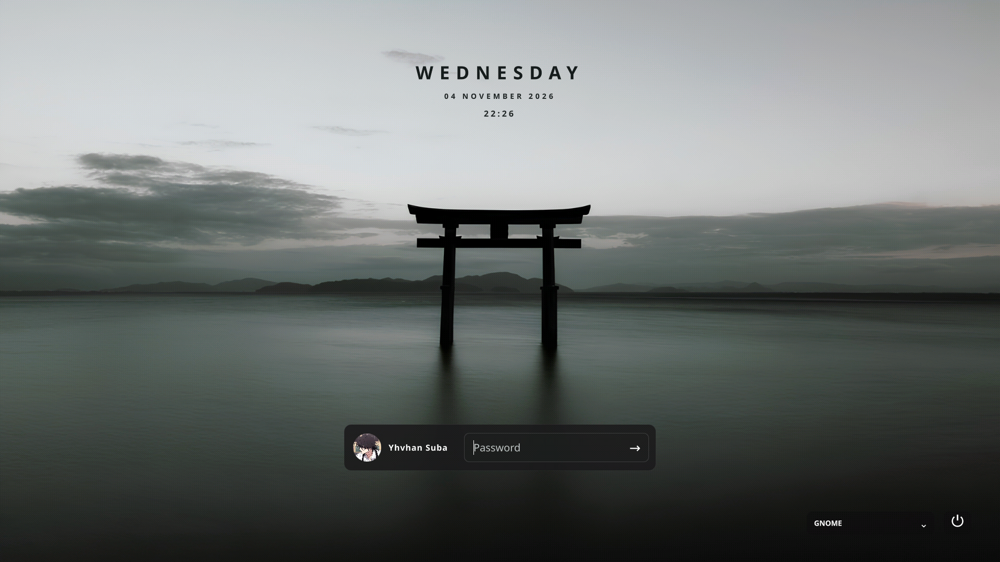

<div align="center">
  
  <p><strong>A monochrome desktop, made personal.</strong><br>Built around Hyprland, Quickshell, and a customized Serpantinum shell.</p>
  <p><a href="#preview">Preview</a> &nbsp; / &nbsp; <a href="#features">Features</a> &nbsp; / &nbsp; <a href="#installation">Installation</a> &nbsp; / &nbsp; <a href="#configuration">Configuration</a> &nbsp; / &nbsp; <a href="#recovery">Recovery</a></p>
</div>

---

  **A desktop shaped around the details**

EvhOS is a personal Wayland desktop setup with a dark, restrained visual language. It brings a customized status bar, dock, launcher, settings panels, notifications, media controls, lock screen, and login theme together into one configuration. This repository captures the current CachyOS setup so it can be adapted to another machine.

EvhOS is a **shell configuration and fork**, not a Linux distribution. It builds on [Serpantinum](https://github.com/ilyamiro/serpantinum), Hyprland, and Quickshell. Internal paths and commands still use `serpantinum` because the components rely on those names.

## Preview

 &nbsp; Four views of the setup

| Desktop and settings | Welcome screen |
| :---: | :---: |
|  |  |
| The desktop, bar, dock, and settings panel. | The EvhOS welcome screen and branding. |
| **Lock screen editor** | **SDDM login** |
|  |  |
| The lock-screen layout shown in its editor. | Torii Minimal, shown in SDDM test mode. |

The login preview uses test-mode session information; available sessions on a real machine depend on what is installed.

## Features

| Component | Included in the snapshot |
| :--- | :--- |
| **Desktop shell** | A customized Quickshell interface, with a floating top bar, dock, launcher, and pop-up panels. |
| **Controls** | Notifications, media, audio, networking, power controls, clipboard and quick actions. Some integrations require optional dependencies. |
| **Appearance** | A monochrome theme, wallpapers, fonts, icons, and the EvhOS avatar and branding. |
| **Lock screen** | A customizable layout with clock, media and other widgets. |
| **Login screen** | A separate Torii-themed SDDM greeter, including wallpaper and profile image. |
| **Recovery** | A restore script that previews its actions and backs up files it replaces. |

## Installation

 &nbsp; Start with an existing Hyprland installation

> **Current status:** The file restore and installer logic have been tested in a disposable directory and with simulated package managers. A complete installation has **not** yet been validated on a fresh Arch, Fedora, or NixOS system. Test on a VM or a spare account before replacing a working desktop.

### 01 / Before you begin

- Install and verify a working **Hyprland session**, with a way to return to a TTY or another desktop if needed.
- Install **Git**, authenticate with the GitHub account that can access this private repository, and clone it.
- Check versions. The snapshot was captured with Hyprland **0.57.0**, Qt **6.12.0**, and the **noctalia-qs 0.0.12** Quickshell fork. The Hyprland configuration uses its Lua API; compatibility with other versions or Quickshell builds is not guaranteed.
- Review the monitor name, app shortcuts, fonts, and hardware-specific paths before logging out. The saved layout targets `eDP-1`.

```sh
git clone https://github.com/ItzEvhyx/EvhOS-Shell.git
cd EvhOS-Shell
```

### 02 / Arch, CachyOS, or Fedora

```sh
./install.sh --plan
./install.sh --enable-services
```

The first command shows the plan and changes nothing. The second checks the packages in enabled repositories, asks for confirmation, installs available dependencies with `pacman` or `dnf`, restores the files, and enables the included user services. Package installation uses `sudo`; run the script as your **normal desktop user**.

To include the SDDM theme on a mutable Arch or Fedora installation, first install SDDM, then add `--sddm`:

```sh
./install.sh --enable-services --sddm
```

The installer reports optional packages it cannot find; the corresponding features may need manual setup. It stops if a required package is unavailable and does not automatically enable third-party repositories or AUR helpers. SDDM is not restarted or enabled automatically.

| Option | Purpose |
| :--- | :--- |
| `--plan` | Preview the selected distro and package lists without making changes. |
| `--enable-services` | Enable the included EvhOS user services after restoration. |
| `--sddm` | Install and configure the Torii SDDM theme on supported mutable systems. |
| `--yes` | Skip the installer confirmation; the package manager may still prompt. |
| `--help` | Show all installer options. |

### 03 / NixOS

NixOS manages system packages declaratively. Import [`nix/evhos-dependencies.nix`](nix/evhos-dependencies.nix) into your existing system configuration and rebuild using your normal NixOS workflow. Then, once Hyprland and the required tools are available to your user, run:

```sh
./install.sh --plan
./install.sh --enable-services
```

The installer does not install NixOS packages imperatively. The dependency module is a best-effort starting point and has not been validated against a fresh NixOS installation. Configure SDDM declaratively instead of using `--sddm`; review any conflicts with Home Manager before restoring files.

### 04 / Review and start

1. Review `~/.config/hypr/`, especially monitor settings, keybindings and paths to local applications.
2. If your monitor is not named `eDP-1`, adjust the saved wallpaper and widget layouts for the new output.
3. Make sure `~/.local/bin` is on your `PATH`, then log in to a Hyprland session. Keep your previous session available until the setup has been checked.
4. Reconnect optional integrations and accounts as needed. Credentials, clipboard history, notes, calendar events and browser data are deliberately excluded.

For distro details, service behavior, and SDDM recovery, see the [installation guide](docs/INSTALL.md) and [compatibility notes](docs/COMPATIBILITY.md).

## Configuration

 &nbsp; Where the pieces live

| Path in this repository | Purpose |
| :--- | :--- |
| `snapshot/shell/src/` | Customized Quickshell source, scripts, and assets. |
| `snapshot/home/.config/hypr/` | Hyprland configuration, shortcuts, and local scripts. |
| `snapshot/home/.config/serpantinum/` | Shell settings and EvhOS branding assets. |
| `snapshot/home/.local/state/serpantinum/` | Selected theme, widget, and lock-screen layout state. |
| `snapshot/system/sddm-theme/` | Torii SDDM greeter and its assets. |
| `install.sh` / `restore.py` | Dependency setup and backup-aware home restoration. |

The included `serp-customizations.timer` periodically reapplies local patches and can overwrite later edits to its target files. Review it before enabling or changing the shell. The repository is a **snapshot**: changes made on your desktop are not uploaded automatically and must be copied back, committed, and pushed.

## Manual restoration

If dependencies are already installed and you only want the saved files:

```sh
python3 restore.py          # preview
python3 restore.py --apply  # restore with backups
```

The restore rewrites the original home path in UTF-8 configuration files and saves replaced files under `~/.local/state/evhos-backups/`. It does not remove unrelated files or restart the session. You can test it in a disposable directory with `python3 restore.py --home /tmp/evhos-test --apply`.

## Recovery

If a new desktop or login screen doesn't work, use your existing alternate session or a TTY to inspect the configuration. User-file backups are in `~/.local/state/evhos-backups/`. The optional SDDM installer keeps a backup when replacing its own existing theme or configuration; other SDDM configuration files may still take precedence. Preview the greeter before enabling it:

```sh
sddm-greeter-qt6 --test-mode --theme "$PWD/snapshot/system/sddm-theme"
```

Preview mode checks appearance; it does not prove a real login will succeed.

## Attribution and assets

EvhOS is based on [Serpantinum](https://github.com/ilyamiro/serpantinum) by ilyamiro and is distributed under the [GNU Affero General Public License v3.0](LICENSE). Some fonts, wallpapers, sounds, and personal artwork may have separate terms. Apple SF and TT Commons fonts were excluded pending redistribution rights; review all assets before making this private repository public.
